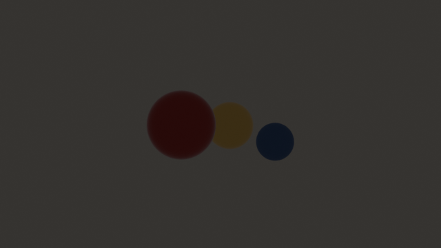
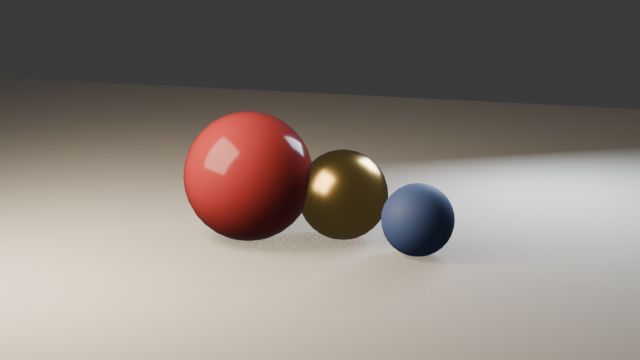
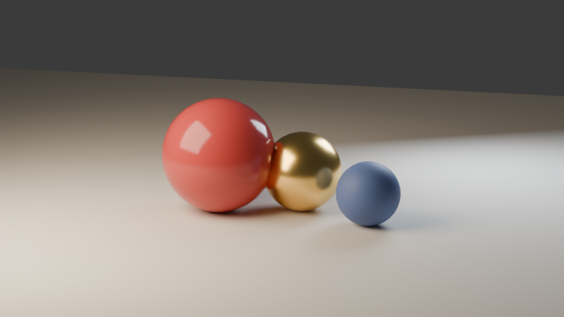

# Visual iteration: the render–critique loop

The core workflow this server enables: Claude renders, **looks at its own
image**, critiques it, and adjusts — no human eyeballs needed between rounds.
Every image below was rendered by Claude through the MCP tools against a live
Blender 4.3.

The prompt:

> *"Build a warm, minimal still life: three glossy spheres on a soft backdrop.
> Make it look like a product-photography test shot."*

## Round 1 — build naively, render a draft

Claude builds the scene with dedicated tools — floor plane, three spheres
(`blender_add_object`), materials (`blender_create_material`), one point
light, and `blender_frame_camera` to aim a fresh camera — then drafts at
640×360, EEVEE, 32 samples. Drafts are cheap on purpose: this one answers
questions, it isn't the deliverable.



**Claude's critique of its own render:** *Severely underlit — a single weak
point light six meters up gives no shadows, no depth, and the materials are
unreadable (the gold sphere reads as brown plastic). Framing is too loose and
too high; the spheres float in dead space. Everything about this says
"default scene", nothing says "product shot".*

## Round 2 — act on the critique

- Swap the point light for a **warm 800 W area key** (5 m soft box,
  45° front-left) via `blender_execute`
- Add a **cool rim light** behind right to separate spheres from backdrop
- Reframe with `blender_frame_camera`: 85 mm lens, elevation down to 14°,
  margin 1.25 — camera drops to "table height" like a real product shot



**Critique:** *Materials now read correctly — gloss on the red, metal on the
gold, matte on the blue. Warm/cool contrast works. Good enough to pay for
quality:* the draft loop ends here.

## Final — spend the samples

`blender_render` with CYCLES, 96 samples, 800×450:



## Why this works

| Habit | Tool |
|---|---|
| Checkpoint before experimenting | `blender_checkpoint` → `blender_undo` |
| Draft cheap (EEVEE 640×360), finish expensive (Cycles) | `blender_render` params |
| Let the math aim the camera | `blender_frame_camera` |
| Critique the *returned image*, not the scene graph | screenshots/renders come back inline |

Try it in this repo with the `/blender-iterate` skill:

```
/blender-iterate a moody cyberpunk desk scene with neon accents
```
