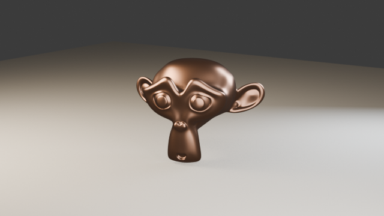
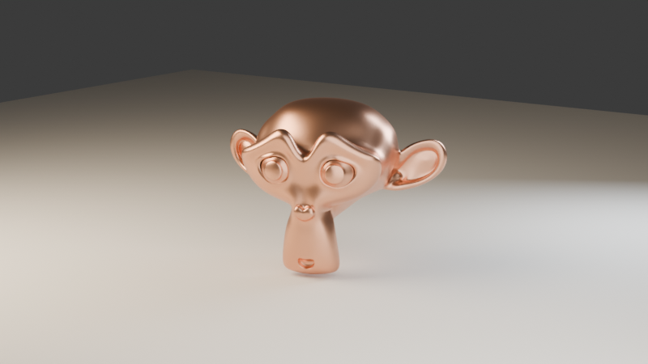

# Studio product shot

A studio-quality hero shot, end to end: subject prep, lighting, framing,
draft, final. Rendered by Claude via MCP against live Blender 4.3 — the same
procedure the `/blender-studio-shot` skill encodes.

The prompt:

> *"Give me a studio product shot of Suzanne in polished copper."*

## 1. Subject prep

```
blender_add_object     monkey → "Demo_Suzanne"
blender_modifier       action=add SUBSURF {levels: 2, render_levels: 3}
blender_modify_object  shade_smooth=true, rotation for a three-quarter pose
blender_create_material  "Copper": base [0.83, 0.42, 0.26], metallic 1.0, roughness 0.32
```

The SUBSURF modifier is what turns the faceted base mesh into the smooth
sculpture in the final image — and `blender_get_object` shows the polygon
count so you can verify it took effect.

## 2. Lighting (three-point, scaled to the subject)

Each light is one `blender_add_object` call with `energy`, `color`, `size`:

- **Key**: warm 800 W area light, 5 m, high front-left
- **Fill**: neutral 300 W area, 6 m, low front-right (half-ish key power,
  bigger and softer)
- **Rim**: cool 400 W area behind right — the edge highlight that separates
  copper from backdrop

## 3. Framing

```
blender_frame_camera  targets=["Demo_Suzanne"] azimuth=305° elevation=12° lens=85 margin=1.35
```

One call replaces all the camera vector math: bounding-sphere fit, look-at
rotation, clip range. 85 mm at low elevation is the classic product look.

## 4. Draft, then final

Draft (EEVEE, 640×360, seconds) to check framing and lighting:



Final (CYCLES, 96 samples, 800×450):



Note what the Cycles final buys over the EEVEE draft: real copper reflections
(the environment and floor visible in the surface), soft shadow falloff, and
color bounce onto the backdrop.

Try it in this repo:

```
/blender-studio-shot MyObject
```
