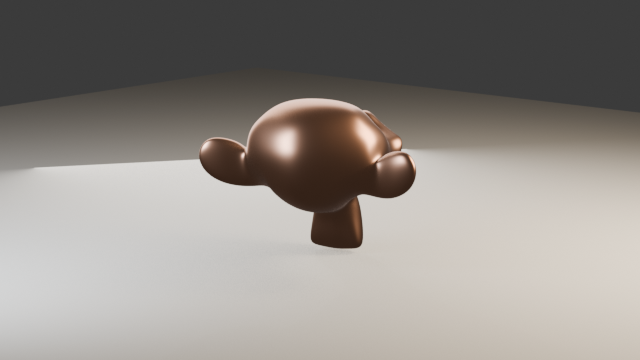
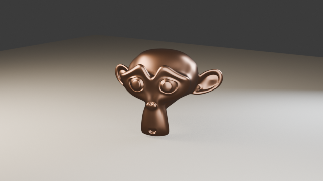

# Turntable animation

A 360° turntable video with `blender_render_animation` — including the trick
that makes it loop cleanly, and how Claude reviews motion it cannot watch.

The prompt:

> *"Make a 1.5 second turntable of the copper Suzanne."*

## The rig: rotate a pivot, not the object

```
blender_add_object    empty → "Demo_Pivot" at the subject's center
blender_frame_camera  aim the camera at the subject first
blender_organize      action=parent  objects=["Demo_Cam"]  parent="Demo_Pivot"
```

Parenting the *camera* to a rotating empty keeps the subject's own transform
(and its lighting!) untouched — the light stays still while the camera
orbits, so the subject's forms are revealed as it turns.

## Animate

```
blender_set_frame_range  1 → 36            (1.5 s at 24 fps)
blender_set_keyframe     Demo_Pivot frame 1  rotation [0, 0, 0]        interpolation=LINEAR
blender_set_keyframe     Demo_Pivot frame 36 rotation [0, 0, 6.28319]  interpolation=LINEAR
```

LINEAR matters: Blender eases keyframes in/out by default, which makes a
looping turntable visibly stutter at the seam.

## Render + review without watching

```
blender_render_animation  frames 1-36, EEVEE, 640×360, preview_frames=3
```

The tool returns the MP4 path **plus evenly spaced preview stills inline**,
so Claude can judge framing and motion coverage without a video player.
36 frames rendered in ~5 seconds on EEVEE:

| Frame 1 | Frame 18 (halfway) | Frame 36 |
|---|---|---|
|  |  |  |

Frame 1 and frame 36 are pixel-identical — 0° and 360° — which is exactly
what a clean loop should look like. The halfway still shows the back of the
subject, confirming full coverage and that the framing margin survives the
whole orbit.

The result: [turntable.mp4](images/turntable.mp4)

(EEVEE renders the copper darker than the Cycles product shot — fine for
motion checks; re-render with `engine="CYCLES"` for the final.)

For anything longer than a quick draft, render it as a background job
instead: `blender_render_job_start` returns at once, and
`blender_render_job_status` reports progress, the ETA and preview frames
(see [04 – Review & background jobs](04-review-and-jobs.md)).

Try it in this repo:

```
/blender-turntable MyObject 4
```
