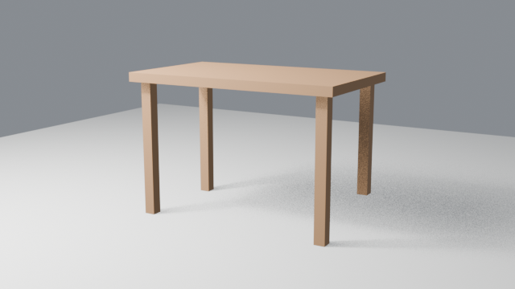
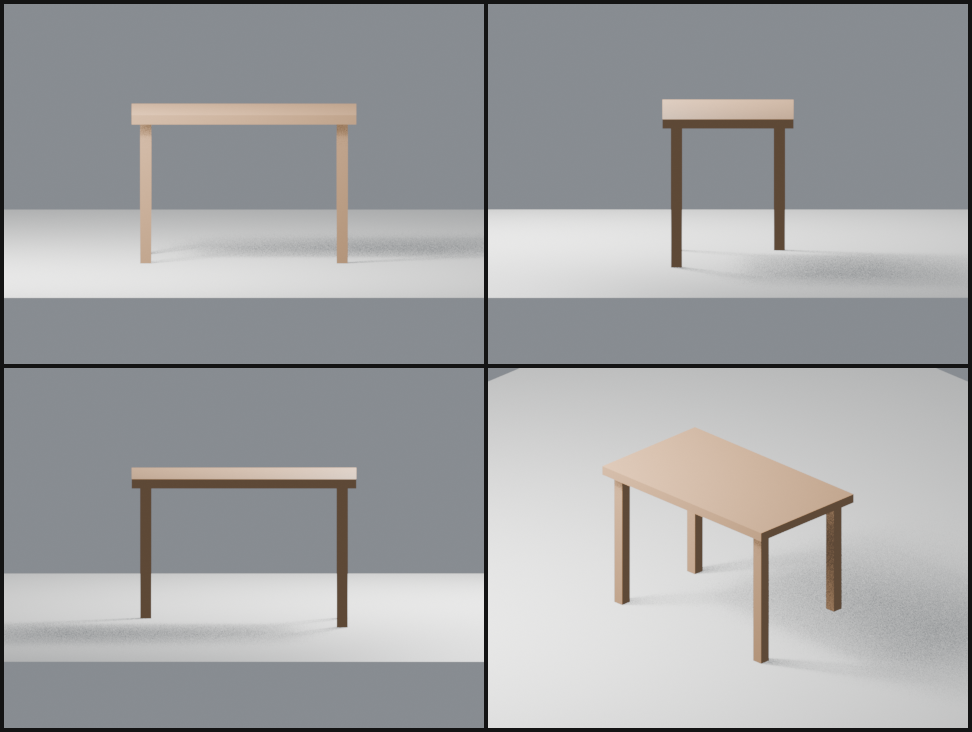
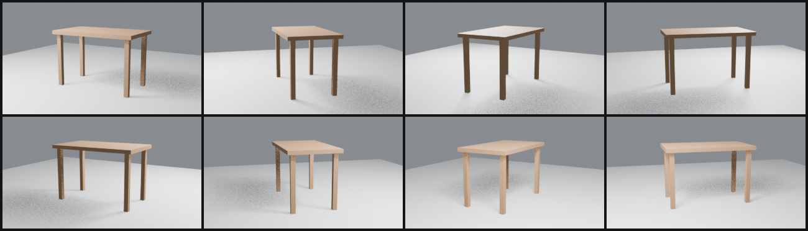

# Review tools and background renders

How Claude checks its own work beyond a single camera angle. The pieces are
a multi-view contact sheet, scene diffs, and turntables that render in the
background while Claude keeps working.

The prompt:

> *"Model a simple wooden table, check it from all sides, then make a quick
> turntable draft."*

## 1. Every `blender_execute` reports what it changed

Claude built the table in one `blender_execute` script. The tool result
ends with a diff of the scene before and after the script, so Claude doesn't
need a follow-up `get_scene` to confirm what happened:

```
Scene changes:
+ added (8): Floor (MESH), Hero_Cam (CAMERA), Key (LIGHT), Table_Leg_1 (MESH),
  Table_Leg_2 (MESH), Table_Leg_3 (MESH), Table_Leg_4 (MESH), Table_Top (MESH)
~ scene: camera None -> 'Hero_Cam'; materials 3 -> 5;
  world_color [0.051, 0.051, 0.051, 1] -> [0.25, 0.27, 0.3, 1]
```

## 2. The hero angle looks fine…



The script had a bug, though. Leg 4 was modelled 25 cm too short. From this
angle the gap blends into the perspective and the shadow.

## 3. …the contact sheet does not

```
blender_render_views  targets=[table parts]  views=[front, right, back, three_quarter]  ortho=true
```



The orthographic right view (top-right) shows the problem: one leg stops
well above the floor. Orthographic projection removes perspective, so legs
that should be the same length look the same length. The sheet uses a
temporary camera, so `Hero_Cam` and the render settings are untouched.

The fix, with its diff:

```
blender_execute  l = bpy.data.objects['Table_Leg_4']; l.scale.z = 0.75; l.location.z = 0.75

Scene changes:
~ changed (1):
    Table_Leg_4: location [1.05, 0.55, 0.875] -> [1.05, 0.55, 0.75];
                 scale [0.06, 0.06, 0.625] -> [0.06, 0.06, 0.75]
```

`blender_snapshot` / `blender_diff` do the same across any span of work.
Take a snapshot, let the user tweak things in the GUI, then diff to see
exactly what they changed.

## 4. Turntable draft as a background job

After parenting the camera to a spinning pivot (see
[03 – Turntable](03-turntable.md)):

```
blender_render_job_start   frame_step=6, 320×180, EEVEE        → job-1, 8 frames
blender_render_job_status  job_id=job-1, wait_seconds=300      → completed
```

`frame_step=6` renders every sixth frame, which is enough to judge the motion
in a fraction of the time. The video's fps is divided to match, so the
draft plays at the right speed. `wait_seconds` long-polls: the call returns
as soon as the job finishes and sends progress notifications meanwhile. The
finished job comes back as a contact sheet of the frames it rendered:



All four legs reach the floor all the way round. For a long Cycles render
the job runs in the background. Claude can keep editing between frames,
check `blender_render_job_status` for the ETA and the newest frame, and call
`blender_render_job_cancel` the moment a preview looks wrong, instead of
waiting out a blocking `blender_render_animation`.
